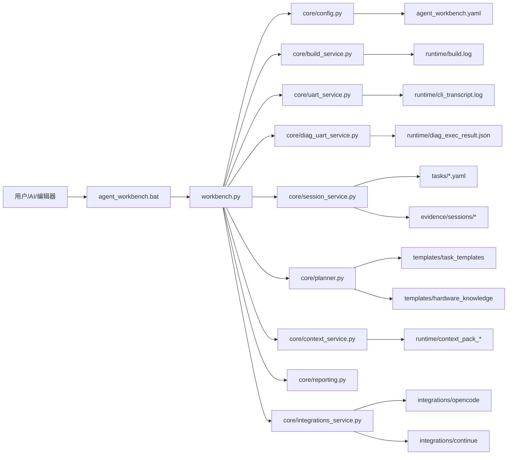
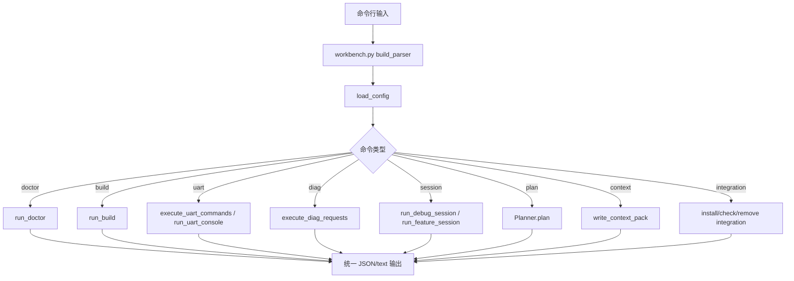
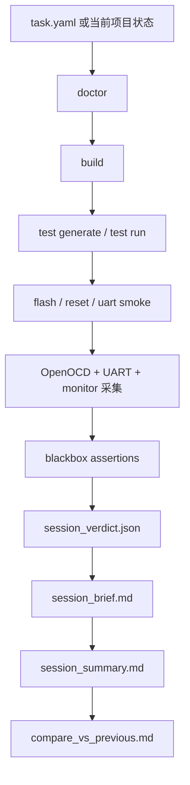
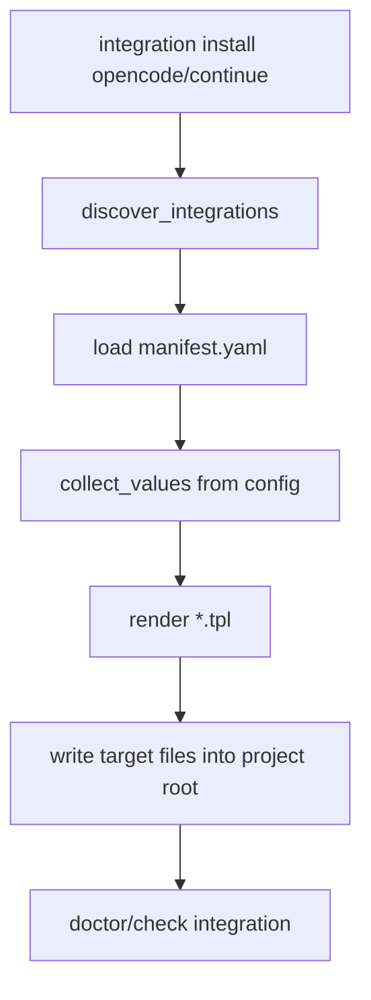
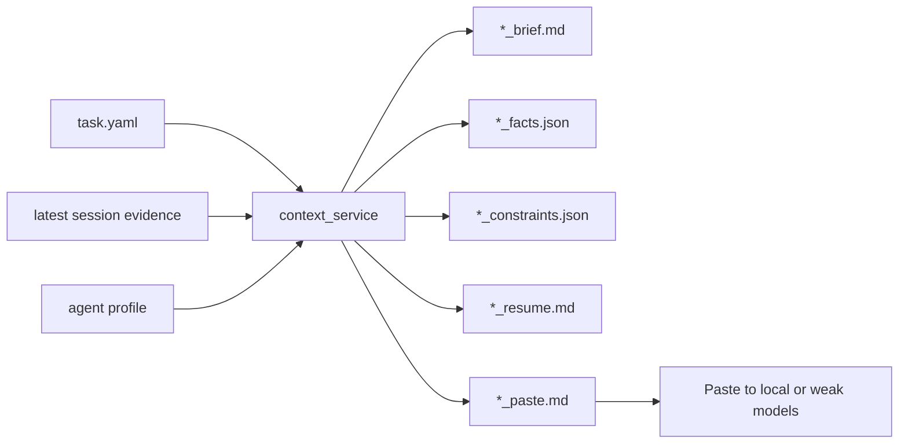

# Agent Workbench 项目设计文档

> 适用对象：
> - 第一次接触 `agent_workbench` 的新人
> - 需要二次开发的维护者
> - 想把该工具链迁移到别的 STM32 UART CLI 项目的人
>
> 阅读建议：
> - 小白先看第 1 到第 5 章，先建立全局认知
> - 开发者重点看第 6 到第 8 章，按目录和文件定位
> - 需要改代码时，优先查 `workbench.py`、`core/`、`templates/`、`tasks/`

## 1. 这个项目到底是干什么的

`agent_workbench` 不是 MCU 固件本身，而是一个围绕 STM32 项目构建的“自动化控制平面”。

它负责把“构建、烧录、串口验证、诊断、会话证据、任务规划、编辑器集成、低上下文模型辅助”这些原本零散的动作，统一收口到一套命令行和一组标准产物上。

如果把整个仓库比作一个工厂：

- `Core/`、`Drivers/` 是真正生产产品的车间，也就是固件源码。
- `agent_workbench/` 是厂务系统，负责流程编排、质检记录、工具集成和操作规范。

一句话概括：

> `agent_workbench` 的目标，是把 STM32 项目的开发过程从“人脑记流程”升级成“工具驱动、证据驱动、可重复执行的工程流程”。

## 2. 设计目标

这个项目从代码和配置上能看出几个非常明确的设计目标：

1. **前端中立**
   `agent_workbench` 本身不绑定某一个 AI 工具或编辑器。核心能力都放在 `workbench.py` 和 `core/`，OpenCode、Continue 之类前端放在 `integrations/`。

2. **证据优先**
   它不鼓励“只看源码就下结论”。很多命令最后都会产出 `session_summary.md`、`cli_diag.json`、`assertions.jsonl`、`compare_vs_*.md` 这类证据文件。

3. **配置单一真源**
   绝大多数运行参数都来自 [`agent_workbench.yaml`](agent_workbench.yaml)，比如构建目录、串口号、ready banner、prompt、flash 方法、model profile。

4. **对弱模型友好**
   通过 `context` 命令把大问题切成 `brief / facts / constraints / resume / paste` 五类小卡片，降低本地小模型或低上下文模型犯错概率。

5. **安全边界明确**
   集成安装做路径越界保护，串口与 OpenOCD 提供状态检查，构建错误会转成结构化建议，避免 AI 直接乱改。

## 3. 新人一分钟看懂项目全貌

先记住下面这条主线：

1. 用户执行 `agent_workbench.bat <command>`
2. `workbench.py` 解析命令
3. `config.py` 读取 `agent_workbench.yaml` 并补齐默认值
4. 对应的 `core/*_service.py` 执行实际能力
5. 结果统一写到 `runtime/`、`generated/`、`evidence/`
6. 如果要对接 OpenCode / Continue，则由 `integrations/` 把模板安装到项目根目录

整体关系如下：

## 4. 核心工作流

### 4.1 命令执行主流程

这是所有命令共享的基础流程：

### 4.2 验证与会话工作流

`verify current` 和 `session feature/debug` 是这个项目最有代表性的能力。

### 4.3 集成安装工作流

`integrations/` 不是直接生效的配置，而是“模板源”。真正安装时会渲染变量再写到项目根目录。

### 4.4 低上下文模型辅助流程

这个流程是 `context` 命令的设计核心。

## 5. 怎么使用这个项目

### 5.1 第一次上手

推荐顺序：

1. 执行 `agent_workbench\bin\setup.bat`
2. 执行 `cmd /c ".\agent_workbench.bat doctor --json"`
3. 执行 `cmd /c ".\agent_workbench.bat init-vscode --json"`
4. 执行 `cmd /c ".\agent_workbench.bat integration list --json"`
5. 按需要安装 `opencode` 或 `continue`

### 5.2 最常用命令

- `doctor`：检查环境、配置、集成、模板、串口后端。
- `build`：配置并构建 CMake 工程。
- `uart exec`：对 CLI 做自动命令验证。
- `diag exec`：向诊断串口发十六进制请求并记录响应。
- `verify current`：一键验证当前任务。
- `session debug`：做一次完整调试会话。
- `session feature --task ...`：围绕任务做特性实现验证。
- `context`：给低上下文模型生成分阶段上下文卡片。
- `plan`：把自然语言需求翻译成可执行 playbook。
- `integration install`：把模板化的 IDE / AI 配置写入项目根目录。

### 5.3 使用时最重要的三条经验

1. 先跑 `doctor` 再跑别的，能省很多排错时间。
2. 能用 `verify current` 就尽量不用手写很长的命令链。
3. 真正判断“成功还是失败”时，看 `runtime/` 和 `evidence/sessions/` 里的证据文件，不要只看终端一句话。

## 6. 目录设计原则

为了避免读代码时迷路，先理解本项目对目录的分层：

- **源代码真源**
  `workbench.py`、`core/`、`templates/`、`tasks/`、`integrations/`、`bin/`、`checks/`、`tests/`

- **知识文档**
  根目录下的说明文档，以及 `docs/`、`examples/`

- **安装模板源**
  `integrations/continue/files/*`、`integrations/opencode/files/*`

- **打包产物**
  `dist/`

- **运行时临时文件**
  `runtime/`

- **历史证据**
  `evidence/`

- **自动生成资产**
  `generated/`

- **第三方依赖或缓存**
  `docs/node_modules/`、`docs/.venv/`、`__pycache__/`

这份文档会**逐个说明源代码真源文件和关键说明文件**。对于 `dist/`、`runtime/`、`evidence/`、`generated/` 这种复制品或运行产物，只说明目录职责，不逐个解释内部所有文件，避免同一内容重复三遍。

## 7. 逐目录、逐文件说明

### 7.1 根目录文件

- [`README.md`](README.md)：项目总入口文档，说明 `agent_workbench` 的定位、常用命令、集成方式和 evidence-first 工作法。新人第一站就是它。
- [`agent_workbench.yaml`](agent_workbench.yaml)：项目唯一配置真源，定义项目根、构建目录、ELF、串口、flash、OpenOCD、monitor、task planner、agent profile 等全部关键参数。
- [`workbench.py`](workbench.py)：统一命令入口，负责 `argparse` 子命令注册、配置加载、命令分发、输出 JSON 封装，是整个系统的“总调度台”。
- [`requirements.txt`](requirements.txt)：Python 依赖清单，目前核心依赖是 `PyYAML` 和 `pyserial`。
- [`ACCEPTANCE_REPORT_AND_GAP_PLAN_ZH.md`](ACCEPTANCE_REPORT_AND_GAP_PLAN_ZH.md)：验收结果与差距清单，用来记录当前能力完成度和未闭环问题。
- [`IMPROVEMENT_PLAN_ZH.md`](IMPROVEMENT_PLAN_ZH.md)：改进路线图，偏向后续迭代计划。
- [`INTEGRATIONS_GUIDE_ZH.md`](INTEGRATIONS_GUIDE_ZH.md)：统一介绍 Continue / OpenCode 集成机制和使用方式。
- [`LOW_CONTEXT_MODELS_GUIDE_ZH.md`](LOW_CONTEXT_MODELS_GUIDE_ZH.md)：专门解释为什么要做 `context pack`，以及弱模型如何安全消费这些上下文卡片。
- [`MIGRATION_GUIDE_ZH.md`](MIGRATION_GUIDE_ZH.md)：把 `agent_workbench` 迁移到别的 STM32 项目时的主说明。
- [`MIGRATION_GUIDE_ZH2.md`](MIGRATION_GUIDE_ZH2.md)：迁移文档的补充版或第二版说明，通常用于保存另一套迁移表达方式。

### 7.2 `bin/`

- [`bin/agent_workbench.bat`](bin/agent_workbench.bat)：Windows 主启动器，先解析 Python，再调用 `workbench.py`。
- [`bin/setup.bat`](bin/setup.bat)：一键初始化脚本，负责检查/安装 Python 依赖，然后自动执行 `doctor` 和 `init-vscode`。
- [`bin/_resolve_python.bat`](bin/_resolve_python.bat)：Python 解释器选择器，会在环境变量、`py -3`、`python`、本地安装目录中找最合适的解释器，并按依赖完整度打分。

### 7.3 `checks/`

- [`checks/preflight.ps1`](checks/preflight.ps1)：PowerShell 版预检入口，本质上是 `doctor` 的薄包装。
- [`checks/build.ps1`](checks/build.ps1)：PowerShell 版构建入口，本质上是 `build` 的薄包装。
- [`checks/unit.ps1`](checks/unit.ps1)：PowerShell 版单测入口，本质上是 `test run` 的薄包装。

### 7.4 `core/` 核心实现层

- [`core/__init__.py`](core/__init__.py)：Python 包标记文件，让 `core` 可以被 `workbench.py` 作为包导入。
- [`core/assertions.py`](core/assertions.py)：执行黑盒断言，支持文件存在、串口输出包含/不包含、prompt、ready、monitor 数值范围等检查，结果写入 `assertions.jsonl`。
- [`core/build_errors.py`](core/build_errors.py)：把 GCC / linker 日志解析成结构化 `BuildError`，并给出建议修复动作，是 `parse-errors` 和 `fix-build` 的基础。
- [`core/build_service.py`](core/build_service.py)：负责拼装 `cmake -S/-B` 和 `cmake --build` 命令，并把构建日志写到指定位置。
- [`core/cli_diag_service.py`](core/cli_diag_service.py)：通过 OpenOCD 读取固件里的 `DebugCliStats` 诊断结构体，对 CLI 失败分类为 `rx_zero`、`parser_no_command`、`tx_or_host_rx`、`ready_missing`、`prompt_missing` 等。
- [`core/cli_output.py`](core/cli_output.py)：统一构建 JSON 输出 payload，让所有子命令输出结构一致。
- [`core/compare_service.py`](core/compare_service.py)：比较两个 session 的 UART、CLI、断言、monitor、diag 结果，产出 `compare_brief.md` 和 `compare_delta.json`。
- [`core/config.py`](core/config.py)：把默认配置和 `agent_workbench.yaml` 合并，解析绝对路径，补齐 `template_values`、profile、输出目录等派生字段。
- [`core/context_service.py`](core/context_service.py)：低上下文模型辅助中心，负责选择合适 session、限制允许读取/修改的文件、生成 `brief/facts/constraints/resume/paste` 五类卡片。
- [`core/diag_uart_service.py`](core/diag_uart_service.py)：诊断串口执行引擎，支持把十六进制请求解析成字节流、发送到串口、记录响应，且在没有 `pyserial` 时提供 PowerShell 兜底。
- [`core/doctor.py`](core/doctor.py)：环境总检查器，验证 Python、YAML、输出目录、toolchain、artifact、compile_commands、OpenOCD、UART 后端、集成、模板数量、迁移文档等。
- [`core/flash_service.py`](core/flash_service.py)：按照配置里的 flash method 执行烧录和复位。
- [`core/hardware_knowledge.py`](core/hardware_knowledge.py)：静态硬件知识库访问层，负责读取时钟、定时器引脚映射、用户代码区模板，并能推导 PWM 参数。
- [`core/integrations_service.py`](core/integrations_service.py)：集成包管理器，负责发现、校验、安装、卸载 `integrations/` 中的模板包，并做路径安全检查。
- [`core/monitor_service.py`](core/monitor_service.py)：变量/寄存器/内存监控引擎，通过 OpenOCD 读取符号或地址，并导出 CSV/JSONL 快照。
- [`core/openocd_client.py`](core/openocd_client.py)：OpenOCD telnet 最小客户端，支持 `connect`、`command`、`halt`、`resume`、读寄存器、读内存。
- [`core/openocd_service.py`](core/openocd_service.py)：OpenOCD 守护进程管理器，负责启动、探活、停止、清理 PID 文件。
- [`core/param_extractor.py`](core/param_extractor.py)：从自然语言需求中提取参数，如 pin、frequency、duty、timer、CLI command name，是 planner 的第一步。
- [`core/planner.py`](core/planner.py)：把用户自然语言请求匹配到 `templates/task_templates/*.yaml`，结合项目扫描结果与硬件知识，生成结构化执行计划。
- [`core/project_scanner.py`](core/project_scanner.py)：扫描工程源码、初始化函数、HAL 句柄、USER CODE 区块、CLI 命令、task 清单和 integration 清单，为 planner 和迁移流程提供事实依据。
- [`core/ps_exec.py`](core/ps_exec.py)：规范化 PowerShell 简化命令，把人类输入转成受支持的 workbench JSON 命令，自动补 `--json`。
- [`core/reporting.py`](core/reporting.py)：根据 evidence 生成 `session_verdict.json`、`session_brief.md`、`session_summary.md`、`feature_summary.md`。
- [`core/session_service.py`](core/session_service.py)：最高级别编排器，串起 doctor、build、test、flash、reset、UART、monitor、assertions、compare、report，形成 debug / feature session。
- [`core/task_spec.py`](core/task_spec.py)：task yaml 标准化器，保证任务最少字段齐全，并自动推导 `implementation.read_candidates`、`edit_candidates` 等默认值。
- [`core/test_service.py`](core/test_service.py)：根据 task 生成黑盒断言文件、单测计划、host test skeleton，并负责执行单元测试命令。
- [`core/uart_service.py`](core/uart_service.py)：CLI 串口主服务，负责 `uart console`、`uart exec`、后台 logger、PowerShell fallback、prompt/ready 检测、日志记录。
- [`core/utils.py`](core/utils.py)：底层工具箱，提供时间戳、目录创建、JSON/JSONL 写入、模板渲染、命令执行、PID 管理、后台进程拉起、读文本等通用函数。
- [`core/vscode_service.py`](core/vscode_service.py)：为 VS Code 生成 `tasks.json` 和项目根包装批处理，让常用命令可以点按钮执行。

### 7.5 `docs/` 说明、脚本与演示材料

#### 7.5.1 文本和脚本文件

- [`docs/AGENT_WORKBENCH_PPT_PLAN_V2_ZH.md`](docs/AGENT_WORKBENCH_PPT_PLAN_V2_ZH.md)：PPT 方案 V2，记录较早版本的演示结构设计。
- [`docs/AGENT_WORKBENCH_PPT_PLAN_V3_ZH.md`](docs/AGENT_WORKBENCH_PPT_PLAN_V3_ZH.md)：PPT 方案 V3，通常作为 V4 的前置草案参考。
- [`docs/AGENT_WORKBENCH_PPT_PLAN_V4_ZH.md`](docs/AGENT_WORKBENCH_PPT_PLAN_V4_ZH.md)：PPT 最新方案文档，描述 V4 版本演示稿的章节设计与内容规划。
- [`docs/AGENT_WORKBENCH_PPT_SCRIPT_ZH.md`](docs/AGENT_WORKBENCH_PPT_SCRIPT_ZH.md)：演讲稿/讲稿版文档，帮助把 PPT 转成口头表达。
- [`docs/build_agent_workbench_ppt.ps1`](docs/build_agent_workbench_ppt.ps1)：PPT 构建脚本，用于自动生成或更新演示文稿。
- [`docs/build_agent_workbench_ppt_editable_v2.ps1`](docs/build_agent_workbench_ppt_editable_v2.ps1)：构建可编辑版 PPT 的脚本，偏向“无嵌入媒体、可二次修改”的输出。
- [`docs/generate_agent_workbench_ppt_assets.py`](docs/generate_agent_workbench_ppt_assets.py)：用 Pillow 生成 PPT 背景图、卡片图和视觉素材。
- [`docs/generate_ppt_v4.js`](docs/generate_ppt_v4.js)：用 `pptxgenjs` 生成 V4 中文 PPT，且会读取项目中的真实 evidence 和 `plan` 输出填充内容。
- [`docs/package.json`](docs/package.json)：Node 侧依赖入口，目前主要依赖 `pptxgenjs`。
- [`docs/package-lock.json`](docs/package-lock.json)：Node 依赖锁文件，保证 PPT 生成环境可复现。
- [`docs/_test_pptx.py`](docs/_test_pptx.py)：对生成出来的 PPTX 做结构检查，比如页数、备注、文本片段、是否嵌入媒体。
- [`docs/history/OPENCODE_AUTO_MODE_GUIDE_ZH.md`](docs/history/OPENCODE_AUTO_MODE_GUIDE_ZH.md)：历史版 OpenCode 自动模式说明，保留演进痕迹。
- [`docs/history/OPENCODE_HARD_SWITCH_EXECUTION_ZH.md`](docs/history/OPENCODE_HARD_SWITCH_EXECUTION_ZH.md)：历史版硬切执行方案记录。
- [`docs/history/OPENCODE_MIGRATION_PLAN_ZH.md`](docs/history/OPENCODE_MIGRATION_PLAN_ZH.md)：历史版 OpenCode 迁移方案文档。

#### 7.5.2 二进制演示材料

下面这些文件是演示输出或素材，不是系统逻辑真源，但对外展示时很重要：

- [`docs/AGENT_WORKBENCH_OVERVIEW_EDITABLE_V2_ZH.pptx`](docs/AGENT_WORKBENCH_OVERVIEW_EDITABLE_V2_ZH.pptx)：可编辑版总览演示稿。
- [`docs/AGENT_WORKBENCH_OVERVIEW_PRO_ZH.pptx`](docs/AGENT_WORKBENCH_OVERVIEW_PRO_ZH.pptx)：更偏成品风格的总览演示稿。
- [`docs/AGENT_WORKBENCH_PPT_V4_ZH.pptx`](docs/AGENT_WORKBENCH_PPT_V4_ZH.pptx)：V4 中文演示稿主成品。
- [`docs/AGENT_WORKBENCH_PPT_V4_ZH - 副本.pptx`](<docs/AGENT_WORKBENCH_PPT_V4_ZH - 副本.pptx>)：V4 演示稿副本，通常用于临时试改或备份。
- [`docs/_drawing_test.png`](docs/_drawing_test.png)：绘图或布局测试输出图。
- [`docs/_ppt_com_test.pptx`](docs/_ppt_com_test.pptx)：PPT COM 接口测试文件。

#### 7.5.3 `docs/ppt_assets/agent_workbench_overview/`

- [`docs/ppt_assets/agent_workbench_overview/slide_01.png`](docs/ppt_assets/agent_workbench_overview/slide_01.png)：第 1 页视觉素材。
- [`docs/ppt_assets/agent_workbench_overview/slide_02.png`](docs/ppt_assets/agent_workbench_overview/slide_02.png)：第 2 页视觉素材。
- [`docs/ppt_assets/agent_workbench_overview/slide_03.png`](docs/ppt_assets/agent_workbench_overview/slide_03.png)：第 3 页视觉素材。
- [`docs/ppt_assets/agent_workbench_overview/slide_04.png`](docs/ppt_assets/agent_workbench_overview/slide_04.png)：第 4 页视觉素材。
- [`docs/ppt_assets/agent_workbench_overview/slide_05.png`](docs/ppt_assets/agent_workbench_overview/slide_05.png)：第 5 页视觉素材。
- [`docs/ppt_assets/agent_workbench_overview/slide_06.png`](docs/ppt_assets/agent_workbench_overview/slide_06.png)：第 6 页视觉素材。
- [`docs/ppt_assets/agent_workbench_overview/slide_07.png`](docs/ppt_assets/agent_workbench_overview/slide_07.png)：第 7 页视觉素材。
- [`docs/ppt_assets/agent_workbench_overview/slide_08.png`](docs/ppt_assets/agent_workbench_overview/slide_08.png)：第 8 页视觉素材。
- [`docs/ppt_assets/agent_workbench_overview/slide_09.png`](docs/ppt_assets/agent_workbench_overview/slide_09.png)：第 9 页视觉素材。
- [`docs/ppt_assets/agent_workbench_overview/slide_10.png`](docs/ppt_assets/agent_workbench_overview/slide_10.png)：第 10 页视觉素材。
- [`docs/ppt_assets/agent_workbench_overview/slide_11.png`](docs/ppt_assets/agent_workbench_overview/slide_11.png)：第 11 页视觉素材。
- [`docs/ppt_assets/agent_workbench_overview/slide_12.png`](docs/ppt_assets/agent_workbench_overview/slide_12.png)：第 12 页视觉素材。

### 7.6 `examples/`

- [`examples/portable_migration.md`](examples/portable_migration.md)：把 `agent_workbench` 移植到别的仓库时的轻量示例说明。

### 7.7 `integrations/continue/`

- [`integrations/continue/README_ZH.md`](integrations/continue/README_ZH.md)：Continue 集成包说明文档，告诉用户如何安装和使用 `.continue/rules/`。
- [`integrations/continue/manifest.yaml`](integrations/continue/manifest.yaml)：Continue 集成包清单，定义需要复制/渲染哪些模板文件，以及 doctor 如何校验安装结果。
- [`integrations/continue/files/rules/stm32_auto_workflow.md.tpl`](integrations/continue/files/rules/stm32_auto_workflow.md.tpl)：Continue 的主流程规则模板，描述 STM32 自动工作流。
- [`integrations/continue/files/rules/stm32_error_recovery.md.tpl`](integrations/continue/files/rules/stm32_error_recovery.md.tpl)：Continue 的错误恢复规则模板。
- [`integrations/continue/files/rules/stm32_hardware_safety.md.tpl`](integrations/continue/files/rules/stm32_hardware_safety.md.tpl)：Continue 的硬件安全边界规则模板。
- [`integrations/continue/files/rules/stm32_model_deepseek_r1.md.tpl`](integrations/continue/files/rules/stm32_model_deepseek_r1.md.tpl)：Continue 针对 DeepSeek-R1 的模型行为规则模板。
- [`integrations/continue/files/rules/stm32_model_glm.md.tpl`](integrations/continue/files/rules/stm32_model_glm.md.tpl)：Continue 针对 GLM 的模型行为规则模板。
- [`integrations/continue/files/rules/stm32_model_qwen7b.md.tpl`](integrations/continue/files/rules/stm32_model_qwen7b.md.tpl)：Continue 针对 Qwen7B 的模型行为规则模板。
- [`integrations/continue/files/rules/stm32_powershell_syntax.md.tpl`](integrations/continue/files/rules/stm32_powershell_syntax.md.tpl)：Continue 的 PowerShell 安全语法规则模板。
- [`integrations/continue/files/rules/stm32_task_cookbook.md.tpl`](integrations/continue/files/rules/stm32_task_cookbook.md.tpl)：Continue 的任务 cookbook 模板，给常见任务套路。
- [`integrations/continue/files/rules/stm32_weak_model_guard.md.tpl`](integrations/continue/files/rules/stm32_weak_model_guard.md.tpl)：Continue 的弱模型保护规则模板。

### 7.8 `integrations/opencode/`

- [`integrations/opencode/README_ZH.md`](integrations/opencode/README_ZH.md)：OpenCode 集成说明，解释 `AGENTS.md`、`.opencode/agent/`、`.opencode/command/` 如何落地。
- [`integrations/opencode/manifest.yaml`](integrations/opencode/manifest.yaml)：OpenCode 集成包清单，定义生成文件与 doctor 检查要求。
- [`integrations/opencode/files/AGENTS.md.tpl`](integrations/opencode/files/AGENTS.md.tpl)：项目级 `AGENTS.md` 模板，是 OpenCode 的主约束入口。
- [`integrations/opencode/files/agent/stm32_auto.md.tpl`](integrations/opencode/files/agent/stm32_auto.md.tpl)：OpenCode 主 agent 模板，告诉模型如何处理 STM32 自动化任务。
- [`integrations/opencode/files/agent/weak_model.md.tpl`](integrations/opencode/files/agent/weak_model.md.tpl)：OpenCode 弱模型 agent 模板，约束低能力模型的行为。
- [`integrations/opencode/files/agent/code_planner.md.tpl`](integrations/opencode/files/agent/code_planner.md.tpl)：OpenCode 代码规划 agent 模板，把 plan 结果转成更具体的修改建议。
- [`integrations/opencode/files/agent/hardware_verifier.md.tpl`](integrations/opencode/files/agent/hardware_verifier.md.tpl)：OpenCode 硬件验证 agent 模板，聚焦 flash / UART / smoke 验证。
- [`integrations/opencode/files/command/fix-build.md.tpl`](integrations/opencode/files/command/fix-build.md.tpl)：OpenCode `/fix-build` slash 命令模板。
- [`integrations/opencode/files/command/flash-reset.md.tpl`](integrations/opencode/files/command/flash-reset.md.tpl)：OpenCode `/flash-reset` slash 命令模板。
- [`integrations/opencode/files/command/plan-stm32.md.tpl`](integrations/opencode/files/command/plan-stm32.md.tpl)：OpenCode `/plan-stm32` slash 命令模板。
- [`integrations/opencode/files/command/uart-smoke.md.tpl`](integrations/opencode/files/command/uart-smoke.md.tpl)：OpenCode `/uart-smoke` slash 命令模板。
- [`integrations/opencode/files/command/verify.md.tpl`](integrations/opencode/files/command/verify.md.tpl)：OpenCode `/verify` slash 命令模板。
- [`integrations/opencode/files/model_profiles/deepseek_r1.md.tpl`](integrations/opencode/files/model_profiles/deepseek_r1.md.tpl)：OpenCode 的 DeepSeek-R1 模型 profile 模板。
- [`integrations/opencode/files/model_profiles/glm.md.tpl`](integrations/opencode/files/model_profiles/glm.md.tpl)：OpenCode 的 GLM 模型 profile 模板。
- [`integrations/opencode/files/model_profiles/qwen7b.md.tpl`](integrations/opencode/files/model_profiles/qwen7b.md.tpl)：OpenCode 的 Qwen7B 模型 profile 模板。
- [`integrations/opencode/files/opencode.json.tpl`](integrations/opencode/files/opencode.json.tpl)：OpenCode 项目级 JSON 配置模板。

### 7.9 `skills_bundle/`

- [`skills_bundle/INSTALL_ZH.txt`](skills_bundle/INSTALL_ZH.txt)：通用 skill 安装说明，告诉用户把压缩包解到什么目录。
- [`skills_bundle/agent-workbench-debug/SKILL.md`](skills_bundle/agent-workbench-debug/SKILL.md)：面向调试场景的通用 skill，强调 evidence-first、直接验证和根因分类。
- [`skills_bundle/agent-workbench-feature/SKILL.md`](skills_bundle/agent-workbench-feature/SKILL.md)：面向特性实现/验证的通用 skill，强调 task 驱动和最小改动。
- [`skills_bundle/agent-workbench-general/SKILL.md`](skills_bundle/agent-workbench-general/SKILL.md)：面向通用 STM32 任务的总 skill，相当于默认操作手册。
- [`skills_bundle/agent-workbench-test/SKILL.md`](skills_bundle/agent-workbench-test/SKILL.md)：面向测试生成、测试执行、测试解释的 skill。

### 7.10 `skills_bundle_model_packs/`

- [`skills_bundle_model_packs/INSTALL_ZH.txt`](skills_bundle_model_packs/INSTALL_ZH.txt)：模型专用 skill 包安装说明。
- [`skills_bundle_model_packs/agent-workbench-deepseek-debug/SKILL.md`](skills_bundle_model_packs/agent-workbench-deepseek-debug/SKILL.md)：DeepSeek 调试专用 skill。
- [`skills_bundle_model_packs/agent-workbench-deepseek-feature/SKILL.md`](skills_bundle_model_packs/agent-workbench-deepseek-feature/SKILL.md)：DeepSeek 特性工作专用 skill。
- [`skills_bundle_model_packs/agent-workbench-deepseek-general/SKILL.md`](skills_bundle_model_packs/agent-workbench-deepseek-general/SKILL.md)：DeepSeek 通用专用 skill。
- [`skills_bundle_model_packs/agent-workbench-deepseek-test/SKILL.md`](skills_bundle_model_packs/agent-workbench-deepseek-test/SKILL.md)：DeepSeek 测试专用 skill。
- [`skills_bundle_model_packs/agent-workbench-qwen-debug/SKILL.md`](skills_bundle_model_packs/agent-workbench-qwen-debug/SKILL.md)：Qwen 调试专用 skill。
- [`skills_bundle_model_packs/agent-workbench-qwen-feature/SKILL.md`](skills_bundle_model_packs/agent-workbench-qwen-feature/SKILL.md)：Qwen 特性工作专用 skill。
- [`skills_bundle_model_packs/agent-workbench-qwen-general/SKILL.md`](skills_bundle_model_packs/agent-workbench-qwen-general/SKILL.md)：Qwen 通用专用 skill。
- [`skills_bundle_model_packs/agent-workbench-qwen-test/SKILL.md`](skills_bundle_model_packs/agent-workbench-qwen-test/SKILL.md)：Qwen 测试专用 skill。

### 7.11 `tasks/` 任务规格

- [`tasks/add_led_status_cli.yaml`](tasks/add_led_status_cli.yaml)：定义“新增 `led_status` CLI 命令”的 feature task，包括作用域、黑盒断言和验证命令。
- [`tasks/cli_automation_regression.yaml`](tasks/cli_automation_regression.yaml)：定义 CLI 自动化回归任务，是当前项目较核心的 feature/verify 基线任务。
- [`tasks/cli_hardware_smoke.yaml`](tasks/cli_hardware_smoke.yaml)：定义真实硬件上的 CLI 烟测任务，偏 debug 验证。
- [`tasks/example_feature.yaml`](tasks/example_feature.yaml)：示例特性任务，目标是新增 `echo` 命令，适合教学或模板参考。
- [`tasks/timer_led_blink.yaml`](tasks/timer_led_blink.yaml)：定义定时器驱动 LED 闪烁的 feature task，适合验证 planner 与 timer 场景。

### 7.12 `templates/`

#### 7.12.1 构建错误规则

- [`templates/build_error_rules.json`](templates/build_error_rules.json)：构建错误模式库，把常见编译报错映射到错误码、类别和建议动作。

#### 7.12.2 硬件知识库

- [`templates/hardware_knowledge/stm32f1_clock.yaml`](templates/hardware_knowledge/stm32f1_clock.yaml)：STM32F1 时钟知识，包含系统频率、各定时器时钟和频率公式。
- [`templates/hardware_knowledge/stm32f1_timer_pin_map.yaml`](templates/hardware_knowledge/stm32f1_timer_pin_map.yaml)：STM32F1 定时器通道到引脚映射，以及常用频率 preset。
- [`templates/hardware_knowledge/stm32f1_user_code_regions.yaml`](templates/hardware_knowledge/stm32f1_user_code_regions.yaml)：CubeMX 用户代码区知识清单，告诉 planner 哪些区块适合放什么内容。

#### 7.12.3 自然语言规划模板

- [`templates/task_templates/adc_read.yaml`](templates/task_templates/adc_read.yaml)：把 ADC 采样、模拟量读取、电压测量类需求翻译成计划。
- [`templates/task_templates/debug_analyze.yaml`](templates/task_templates/debug_analyze.yaml)：把故障分析、串口异常、回归诊断类需求翻译成只读优先计划。
- [`templates/task_templates/dma_transfer.yaml`](templates/task_templates/dma_transfer.yaml)：把 DMA 搬运、缓冲区、外设传输类需求翻译成计划。
- [`templates/task_templates/exti_input.yaml`](templates/task_templates/exti_input.yaml)：把 EXTI 输入、按键边沿、中断输入类需求翻译成计划。
- [`templates/task_templates/fault_diagnosis.yaml`](templates/task_templates/fault_diagnosis.yaml)：把 hardfault、panic、断言失败类需求翻译成诊断计划。
- [`templates/task_templates/gpio_blink.yaml`](templates/task_templates/gpio_blink.yaml)：把 LED/GPIO 闪烁类需求翻译成计划。
- [`templates/task_templates/gpio_output.yaml`](templates/task_templates/gpio_output.yaml)：把 GPIO 输出、电平切换、继电器控制类需求翻译成计划。
- [`templates/task_templates/i2c_device.yaml`](templates/task_templates/i2c_device.yaml)：把 I2C 设备接入与寄存器读写类需求翻译成计划。
- [`templates/task_templates/interrupt_handler.yaml`](templates/task_templates/interrupt_handler.yaml)：把 IRQ 回调和中断处理类需求翻译成计划。
- [`templates/task_templates/monitor_watch.yaml`](templates/task_templates/monitor_watch.yaml)：把运行时监控、变量观察类需求翻译成调试计划。
- [`templates/task_templates/sensor_polling.yaml`](templates/task_templates/sensor_polling.yaml)：把周期采样、轮询、状态聚合类需求翻译成计划。
- [`templates/task_templates/spi_device.yaml`](templates/task_templates/spi_device.yaml)：把 SPI 设备驱动、片选时序类需求翻译成计划。
- [`templates/task_templates/timer_basic.yaml`](templates/task_templates/timer_basic.yaml)：把基本定时器、节拍任务类需求翻译成计划。
- [`templates/task_templates/timer_pwm.yaml`](templates/task_templates/timer_pwm.yaml)：把 PWM、蜂鸣器、频率/占空比控制类需求翻译成计划，是硬件知识利用最典型的模板之一。
- [`templates/task_templates/uart_cli_command.yaml`](templates/task_templates/uart_cli_command.yaml)：把 CLI 命令新增、帮助文本扩展类需求翻译成计划。
- [`templates/task_templates/uart_echo.yaml`](templates/task_templates/uart_echo.yaml)：把串口回显、简单文本命令类需求翻译成计划。

### 7.13 `tests/`

- [`tests/__init__.py`](tests/__init__.py)：测试包标记文件。
- [`tests/data/planner_regression_cases.json`](tests/data/planner_regression_cases.json)：planner 回归用例库，用来防止模板匹配和计划生成退化。
- [`tests/test_assertions.py`](tests/test_assertions.py)：验证 `core/assertions.py` 的断言判定逻辑。
- [`tests/test_build_errors.py`](tests/test_build_errors.py)：验证 `core/build_errors.py` 的错误解析与建议修复生成。
- [`tests/test_build_service.py`](tests/test_build_service.py)：验证 `core/build_service.py` 的命令拼装和构建流程。
- [`tests/test_cli_core_host.py`](tests/test_cli_core_host.py)：验证 CLI 主机侧核心行为，偏串口自动化主路径。
- [`tests/test_compare.py`](tests/test_compare.py)：验证 session 对比报告生成逻辑。
- [`tests/test_context_service.py`](tests/test_context_service.py)：验证 context pack 选择、限额、卡片生成逻辑。
- [`tests/test_diag_uart_service.py`](tests/test_diag_uart_service.py)：验证诊断串口请求解析与执行结果封装。
- [`tests/test_doctor.py`](tests/test_doctor.py)：验证环境体检逻辑和关键检查点。
- [`tests/test_hardware_knowledge.py`](tests/test_hardware_knowledge.py)：验证静态硬件知识的读取与 PWM 推导。
- [`tests/test_integrations_service.py`](tests/test_integrations_service.py)：验证 integration manifest 解析、安装、校验和卸载流程。
- [`tests/test_param_extractor.py`](tests/test_param_extractor.py)：验证自然语言参数提取器。
- [`tests/test_planner.py`](tests/test_planner.py)：验证 planner 的模板匹配与计划生成。
- [`tests/test_planner_e2e.py`](tests/test_planner_e2e.py)：验证 planner 端到端流程，确保扫描、参数提取、模板渲染能协同工作。
- [`tests/test_planner_regression_suite.py`](tests/test_planner_regression_suite.py)：用回归用例集守住 planner 输出不被意外改坏。
- [`tests/test_project_scanner.py`](tests/test_project_scanner.py)：验证项目扫描器对源码、任务、集成、用户代码区等信息的提取。
- [`tests/test_session_service.py`](tests/test_session_service.py)：验证会话编排与 direct verify 逻辑。
- [`tests/test_task_spec.py`](tests/test_task_spec.py)：验证 task yaml 规范化逻辑。
- [`tests/test_uart_service.py`](tests/test_uart_service.py)：验证 CLI 串口执行、prompt/ready 识别和 fallback 行为。
- [`tests/test_vscode_service.py`](tests/test_vscode_service.py)：验证 VS Code 任务文件和包装脚本生成。

## 8. 目录级但不逐个展开的内容

下面这些目录很重要，但**不适合逐个文件解释**，因为它们大多是复制品、运行时产物或第三方依赖：

### 8.1 `dist/`

这是发布打包目录。里面的 zip 包和解压后的技能/提示词内容，本质上都是从 `skills_bundle/`、`skills_bundle_model_packs/`、`integrations/` 等真源目录复制出来的发行物。维护时请改真源，不要直接改 `dist/`。

### 8.2 `generated/`

这是自动生成的任务资产目录。比如：

- `implementation_brief.md`
- `unit_test_plan.md`
- `task_snapshot.json`
- `*_host_test_skeleton.c`

这些文件是“由 task 推导出来的工作中间件”，不是系统真源。

### 8.3 `runtime/`

这是“最近一次运行”的临时目录。常见文件包括：

- `build.log`
- `cli_transcript.log`
- `doctor_report.json`
- `direct_verify_summary.md`
- `context_pack_*`

它们适合用来排查当前问题，不适合长期手改。

### 8.4 `evidence/`

这是历史 session 证据仓。每个子目录对应一次完整会话，保存：

- `session_manifest.json`
- `events.jsonl`
- `session_verdict.json`
- `session_summary.md`
- `feature_summary.md`
- `cli_transcript.log`
- `assertions.jsonl`

这是最重要的“历史证据库”，但同样不应该手工长期维护。

### 8.5 `docs/node_modules/` 与 `docs/.venv/`

这两个目录是文档/PPT 生成用的第三方依赖，不属于本项目手写逻辑层。只有在环境损坏或升级依赖时才需要关注。

### 8.6 `__pycache__/`

Python 缓存目录，可忽略。

### 8.7 `prompts/`

当前仓库里预留了 `prompts/` 目录，但没有实际提示词文件。它更像向后兼容的扩展位，未来如果恢复老提示词模式，可能会在这里落文件。

## 9. 这个项目最关键的几个设计点

### 9.1 `agent_workbench.yaml` 是总开关

几乎所有核心能力都依赖它。你改了串口号、build 目录、OpenOCD 启动命令、task template 目录、agent profile，最终都会影响命令执行结果。

所以维护原则是：

1. 先改 YAML
2. 再跑 `doctor`
3. 再跑 `build` / `verify`

### 9.2 `core/` 的职责划分很清楚

这个项目整体上是“命令分发 + service 化实现”的风格：

- `*_service.py` 负责业务动作
- `utils.py` 提供公共能力
- `workbench.py` 只做组织，不做重逻辑

这是一个非常适合后续扩展的结构。比如你要加 `gdb`、`log export`、`artifact pack` 命令，完全可以继续按这个模式扩。

### 9.3 `planner` 很有价值，但不是万能的

从本次实际观察可以看到，`plan` 对 STM32 功能需求很强，但对“写项目文档”这种非硬件任务会误匹配到 `gpio_output` 模板。

这说明当前 planner 的边界是：

- 擅长：GPIO、PWM、UART、I2C、SPI、DMA、fault、monitor 这类 MCU 场景
- 不擅长：纯文档、纯演示稿、纯组织治理类任务

如果后面要扩大 planner 使用范围，建议：

1. 增加文档类模板
2. 增加“请求分类器”先分领域，再做模板匹配
3. 对无法识别的请求明确返回 “non-hardware request”

### 9.4 `task` 和 `template` 是两种完全不同的东西

很多新人会混淆这两个目录：

- `tasks/*.yaml`：已经明确好的任务规格，像测试用例或验收单
- `templates/task_templates/*.yaml`：把自然语言翻译成计划的模板库

可以这样记：

- `task` 是“这次要做什么”
- `template` 是“遇到这类需求通常怎么做”

### 9.5 `integrations/` 是安装源，不是最终配置

`integrations/opencode/files/*.tpl` 和 `integrations/continue/files/*.tpl` 都只是模板。

真正被 AI 工具消费的是安装后生成到项目根目录的：

- `AGENTS.md`
- `.opencode/*`
- `.continue/rules/*`
- `opencode.json`

所以如果你发现生成结果不对：

1. 先看 `manifest.yaml`
2. 再看对应 `.tpl`
3. 然后重新执行 `integration install`

## 10. 新人应该按什么顺序读代码

最推荐的阅读顺序是：

1. [`README.md`](README.md)
2. [`agent_workbench.yaml`](agent_workbench.yaml)
3. [`workbench.py`](workbench.py)
4. [`core/config.py`](core/config.py)
5. [`core/doctor.py`](core/doctor.py)
6. [`core/build_service.py`](core/build_service.py)
7. [`core/uart_service.py`](core/uart_service.py)
8. [`core/session_service.py`](core/session_service.py)
9. [`core/reporting.py`](core/reporting.py)
10. [`core/planner.py`](core/planner.py)
11. [`core/context_service.py`](core/context_service.py)
12. [`templates/`](templates/)
13. [`tasks/`](tasks/)
14. [`integrations/`](integrations/)
15. [`tests/`](tests/)

为什么这么排：

- 前 3 步先知道“系统想干什么、入口在哪”
- 中间 6 步看懂“系统怎么跑”
- 后 6 步看懂“系统如何扩展、如何验证、如何对接前端”

## 11. 如果要扩展功能，应该改哪里

### 11.1 新增一个命令

通常要改：

1. [`workbench.py`](workbench.py)：加子命令解析
2. `core/xxx_service.py`：实现能力
3. [`tests/`](tests/)：补测试
4. 视情况更新 [`README.md`](README.md) 和 [`agent_workbench.yaml`](agent_workbench.yaml)

### 11.2 新增一种自然语言需求类型

通常要改：

1. [`templates/task_templates/*.yaml`](templates/task_templates)
2. 视情况补 [`templates/hardware_knowledge/*.yaml`](templates/hardware_knowledge)
3. [`tests/test_planner.py`](tests/test_planner.py)
4. [`tests/test_planner_regression_suite.py`](tests/test_planner_regression_suite.py)

### 11.3 新增一种 task 验证任务

通常要改：

1. 在 [`tasks/`](tasks/) 新建一个 task yaml
2. 用 [`core/task_spec.py`](core/task_spec.py) 现有规范消费它
3. 让 [`core/test_service.py`](core/test_service.py) 自动生成衍生资产
4. 用 `verify current --task ...` 验证

### 11.4 新增一种 AI / 编辑器集成

通常要改：

1. 新建 `integrations/<name>/manifest.yaml`
2. 在 `integrations/<name>/files/` 放模板
3. 写 `README_ZH.md`
4. 补 [`tests/test_integrations_service.py`](tests/test_integrations_service.py)

## 12. 最后给维护者的建议

如果你后续要长期维护这个项目，我建议始终坚持下面四条：

1. **不要直接依赖终端输出做人类判断**
   尽量让命令写 JSON 或证据文件，再基于证据文件做总结。

2. **每增加一条自动化能力，都配一个 task 或 test**
   否则系统会越来越像脚本集合，而不是可靠工具链。

3. **把“规则”放模板，把“事实”放 evidence**
   模板是可维护的知识，evidence 是一次执行的结果，不要混写。

4. **优先修正配置和模板边界，再让 AI 更自由**
   这个项目的优势就在于“边界清楚”。边界一松，误操作风险就会上来。

---

如果只想记住一句话：

> `agent_workbench` 的核心价值，不是多了几条命令，而是把 STM32 项目的开发、验证、排错、集成和证据沉淀，变成了一套可重复、可审计、可迁移的工程流程。
