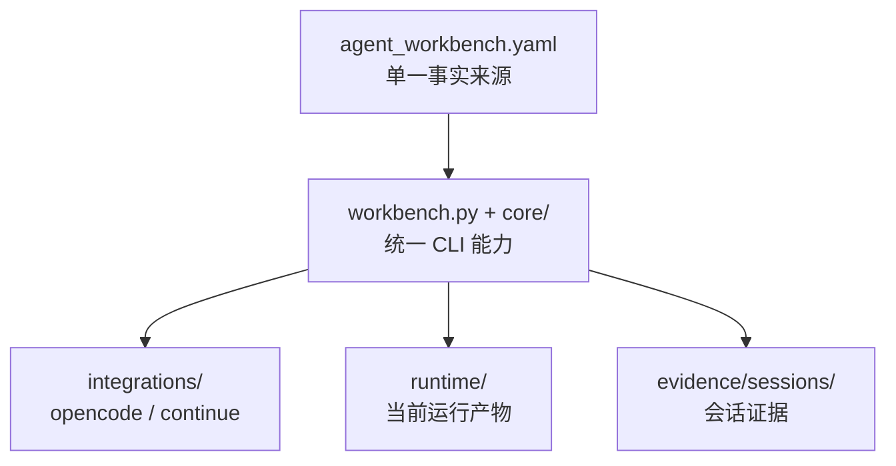

# agent_workbench 使用介绍 PPT 讲稿

面向对象：研发同事  
建议时长：5-10 分钟  
建议页数：8 页  
主叙事：`单一配置源 -> 统一命令入口 -> AI/编辑器集成 -> 证据驱动验证 -> 低上下文模型可稳定使用`

## 使用建议

- 这份文档按“可直接做稿”组织，每页都给出标题、页面文案、讲稿要点和截图建议。
- 内容默认只介绍 `agent_workbench` 本体，`OpenCode` 只作为一个 integration 示例出现。
- 如果时间只有 5 分钟，优先讲第 2、3、5、7、8 页。

## Slide 1

### 标题

`agent_workbench：把 STM32 + AI 研发流程做成可复用闭环`

### 副标题

`面向研发同事的 5-10 分钟上手介绍`

### 页面文案

- 面向 STM32 项目的自动化控制平面
- 把构建、串口、验证、报告和 AI 集成收敛到统一入口
- 目标不是“更会聊天”，而是“更稳地交付和验证”

### 讲稿要点

- 今天不讲具体业务功能怎么开发，只讲 `agent_workbench` 这套工作台本身。
- 可以把它理解成 STM32 项目的“自动化控制平面”，负责把零散命令、硬件验证和 AI 协作统一起来。
- 听完之后，希望大家能回答 3 个问题：它解决什么问题、第一次怎么上手、为什么它的结果更可信。

### 截图建议

- 不需要复杂截图，封面可直接用标题页。
- 背景建议用“终端 + 配置文件 + 串口日志”拼图，突出它连接的是完整流程，而不是单个工具。

## Slide 2

### 标题

`为什么需要 agent_workbench`

### 页面文案

- 命令入口分散：构建、烧录、串口、验证各有各的命令
- 硬件参数容易靠记忆和口口相传，稳定性差
- 验证结论经常停留在“我看起来像是好了”
- 更换 OpenCode / Continue / 其他前端时，项目适配重复维护

### 讲稿要点

- STM32 场景和纯软件项目不一样，问题不只是“改代码”，还包括构建、烧录、串口连通、CLI 烟测和结果留痕。
- 如果没有统一入口，大家往往会在本地各自记一套命令，迁移机器和换人协作时容易失真。
- 如果 AI 直接靠长提示词和仓库印象工作，最容易出问题的就是“猜硬件”“猜状态”“猜已经修好”。
- `agent_workbench` 解决的不是单个命令，而是把这些高风险环节拉进一个可复用流程。

### 截图建议

- 这页建议用 4 个痛点图标，不强依赖仓库截图。
- 如果想放真实素材，可截 `README.md` 中 Main Commands 区块的一小部分，作为“命令很多、需要统一入口”的背景。

## Slide 3

### 标题

`它到底是什么`

### 页面文案

`agent_workbench` 是面向 STM32 项目的自动化控制平面。  
它把构建、烧录、串口、诊断、规划、验证、报告和 AI/editor 集成收敛到统一 CLI 和统一配置里。

- 单一事实来源：`agent_workbench.yaml`
- 统一入口：`agent_workbench.bat`
- 核心能力和前端适配解耦
- 输出的不只是命令结果，还有可复盘 evidence

### 讲稿要点

- 这里最重要的关键词不是 AI，而是“控制平面”。
- `agent_workbench.yaml` 把项目、构建目录、串口、烧录方式、输出目录和模型 profile 集中描述。
- `workbench.py` 和 `core/` 提供核心 CLI；`opencode`、`continue` 只是装在上面的 integration。
- 所以它不是某一个前端的私有脚本，而是前端可替换、流程可复用的一层。

### 截图建议

- 截图文件：[README.md](../README.md)
- 建议位置：`Main Commands` 和 `Integrations` 两个区块。
- 建议高亮：`doctor`、`build`、`plan`、`verify current`、`integration install opencode`。

## Slide 4

### 标题

`核心架构：配置、CLI、集成、证据四层`

### 页面文案

- `agent_workbench.yaml`：单一事实来源
- `workbench.py + core/`：统一 CLI 能力
- `integrations/`：OpenCode / Continue 等前端适配
- `runtime/` 与 `evidence/sessions/`：当前产物和会话证据

### 架构图草案

```text
agent_workbench.yaml
        |
        v
workbench.py + core/
doctor | plan | build | verify | context | uart | report
        |
        +--> integrations/
        |    opencode | continue
        |
        +--> runtime/
        |    当前运行产物
        |
        +--> evidence/sessions/
             可复盘会话证据
```

### 可选 Mermaid 版本



### 讲稿要点

- 这一页要强调“前端中立”和“配置集中”。
- 以后如果要支持新的 AI 前端，理想情况是新增一个 integration 包，而不是去改核心逻辑。
- 这也解释了为什么 `OpenCode` 不是 workbench 本体，它只是其中一个接入面。
- 真正让这套流程稳下来的，是右边这两个目录：`runtime/` 和 `evidence/sessions/`。

### 截图建议

- 截图文件：[agent_workbench.yaml](../agent_workbench.yaml)
- 建议位置：顶部的 `project`、`outputs`、`uart` 段落。
- 建议高亮：`build_dir`、`runtime_root`、`evidence_root`、`uart.port`、`ready_banner`、`prompt`。

## Slide 5

### 标题

`日常最小使用路径`

### 页面文案

```powershell
cmd /c ".\agent_workbench.bat doctor --json"
cmd /c ".\agent_workbench.bat integration install opencode --json"
cmd /c ".\agent_workbench.bat plan ""add PWM output on PA8, 1kHz, 50% duty"" --json"
cmd /c ".\agent_workbench.bat build --json"
cmd /c ".\agent_workbench.bat verify current --task agent_workbench/tasks/cli_automation_regression.yaml --json"
```

- `doctor`：先确认环境和配置是通的
- `integration install opencode`：给前端生成项目级接入文件
- `plan`：把自然语言需求转成可执行 playbook
- `build`：统一走构建入口
- `verify current`：用一条命令做完整验证闭环

### 讲稿要点

- 这里不要讲所有参数，只讲为什么这 5 步足够代表日常使用路径。
- 第一层是“环境可用”，第二层是“前端可接入”，第三层是“需求可结构化”，第四层是“产物可构建”，第五层是“结果可验证”。
- 对听众来说，关键结论是：第一次上手不用记很多散命令，先记住这 5 个动作就够了。

### 截图建议

- 截图文件：[README.md](../README.md)
- 建议位置：`Quick Start` 和 `Main Commands`。
- 建议做法：把这 5 条命令整理成一张流程箭头图，而不是直接大段代码截图。

## Slide 6

### 标题

`为什么它对 AI 更友好`

### 页面文案

- `*_brief.md`：给人快速读的一屏摘要
- `*_facts.json`：只保留可引用事实
- `*_constraints.json`：约束本轮允许读取和修改的边界
- `*_paste.md`：给 OpenCode 直接粘贴的最短提示
- `*_resume.md`：上下文满了以后直接续接
- `agent_state.json`：记录当前模式、阶段、profile 和下一步

### 讲稿要点

- 这页要传达的核心不是“能生成多少文件”，而是“把原来放在模型脑子里的东西，转移到 workbench 产物里”。
- 小上下文模型最怕两件事：一次性喂太多，以及没有边界就乱猜。
- `context` 的价值在于让一轮只处理一个阶段，比如只分析、只实现、只验证，而不是让模型自由发挥。
- 这也是它比“长提示词 + 全仓库通读”更稳的原因。

### 截图建议

- 截图文件：[LOW_CONTEXT_MODELS_GUIDE_ZH.md](../LOW_CONTEXT_MODELS_GUIDE_ZH.md)
- 建议位置：`每个阶段会生成什么` 这一节。
- 建议高亮：`*_brief.md`、`*_facts.json`、`*_constraints.json`、`*_paste.md`、`agent_state.json`。

## Slide 7

### 标题

`为什么结果更可信`

### 页面文案

- 结论不是模型口头判断，而是来自 evidence
- `direct_verify_summary.md` 会把各阶段状态显式写出来
- `session_summary.md` 会保留 verdict、断言统计和 CLI 关键片段
- `build.log`、`cli_transcript.log`、`assertions.jsonl` 可以回放和复盘

### 建议展示的真实点

- `direct_verify_summary.md` 里同时出现：
  - `doctor: pass`
  - `build: pass`
  - `test_run: fail`
  - `uart_smoke: pass`
- `session_summary.md` 里出现：
  - `verdict: pass`
  - `assertions: pass=10 fail=0 skip=0`
  - `strongest_evidence: saw_ready=True saw_prompt=True`

### 讲稿要点

- 一套可靠流程最重要的不是只展示成功，而是失败也要被结构化暴露出来。
- `direct_verify_summary.md` 的价值在于告诉你是哪一步失败，而不是只给一个含糊的“没过”。
- `session_summary.md` 的价值在于把 verdict、断言数量和关键 transcript 放在一起，方便复盘和对外说明。
- 所以最后的结论不是“AI 说修好了”，而是“构建、串口、断言和会话摘要共同证明了当前状态”。

### 截图建议

- 截图文件：[direct_verify_summary.md](../runtime/direct_verify_summary.md) 和 [session_summary.md](../evidence/sessions/cli_automation_regression/session_summary.md)
- 建议做法：左右双栏放两张截图。
- 左侧高亮：`test_run: fail` 和 `uart_smoke: pass`。
- 右侧高亮：`verdict: pass`、`assertions: pass=10 fail=0 skip=0`、`strongest_evidence`。

## Slide 8

### 标题

`真实示例：CLI 自动化回归如何闭环`

### 页面文案

- 任务定义：保持 USART2 文本 CLI 适合自动化回归
- 验证顺序：`doctor -> build -> test -> debug`
- 黑盒断言：ready banner、prompt、help/status、LED 命令响应
- 最终结果：`pass=10 fail=0 skip=0`

### 建议展示的 4 步

1. 任务文件定义目标和范围  
2. `verify.sequence` 定义验证路径  
3. `acceptance.blackbox` 定义可机器判断的标准  
4. `session_summary.md` 给出最终 verdict

### 讲稿要点

- 这一页是全场收尾，要让听众看到“从任务定义到结果判定”的闭环。
- 示例任务不是抽象口号，而是已经把目标、scope、acceptance、verify sequence 写进 YAML。
- 当 `verify current` 跑完后，结果会沉淀成可回看的 session 目录，这才是工程记录。
- 讲到这里可以收束成一句话：`agent_workbench` 的价值，不只是帮 AI 干活，而是把这次干活变成一条可以复用、验证和复盘的流水线。

### 截图建议

- 截图文件：[cli_automation_regression.yaml](../tasks/cli_automation_regression.yaml)
- 建议位置：`acceptance` 和 `verify` 两段。
- 配套结果图：放 [session_summary.md](../evidence/sessions/cli_automation_regression/session_summary.md) 中 `assertions` 那一段。

## 结尾话术

- 如果只记一件事，可以记住：`agent_workbench` 不是某个 AI 前端的附属脚本，而是 STM32 项目的自动化控制平面。
- 如果只记一个上手动作，可以记住：先跑 `doctor`，再通过统一 CLI 去接入、规划、构建和验证。
- 如果只记一个判断标准，可以记住：最终结论要看 evidence，而不是看模型说了什么。

## 可选附录

### 可选附录 A：一页命令分组

- 环境与接入：`doctor`、`init-vscode`、`integration list/install/check/remove`
- 开发与实现：`scan-project`、`plan`、`build`
- 硬件与验证：`flash`、`reset`、`uart`、`diag`、`verify`
- 证据与复盘：`report`、`compare`、`context`

### 可选附录 B：现场演示顺序

1. 打开 [agent_workbench.yaml](../agent_workbench.yaml)，强调单一事实来源  
2. 打开 [README.md](../README.md)，指出统一 CLI 命令  
3. 打开 [LOW_CONTEXT_MODELS_GUIDE_ZH.md](../LOW_CONTEXT_MODELS_GUIDE_ZH.md)，说明 `context` 产物  
4. 打开 [cli_automation_regression.yaml](../tasks/cli_automation_regression.yaml)，说明任务定义  
5. 打开 [session_summary.md](../evidence/sessions/cli_automation_regression/session_summary.md)，展示 evidence 闭环

### 可选附录 C：版式建议

- 封面和架构页可偏深色，命令页和证据页建议浅底深字，方便投屏。
- 命令、路径、文件名统一用等宽字体。
- 每页最多保留 3-4 个关键点，演讲信息尽量放在讲稿里，不要堆满正文。
